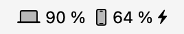
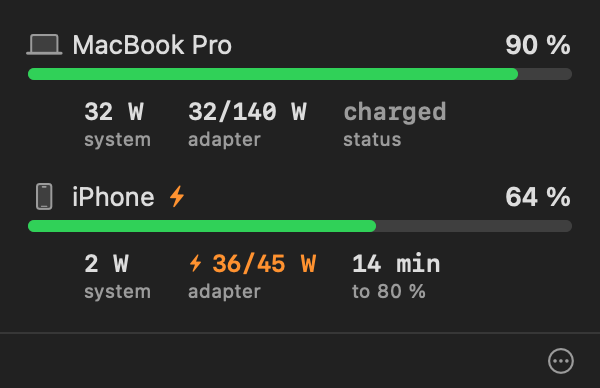
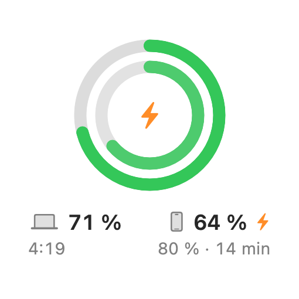
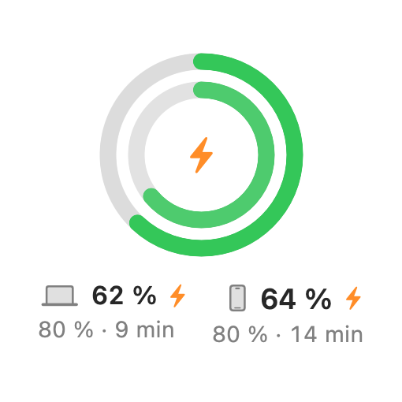
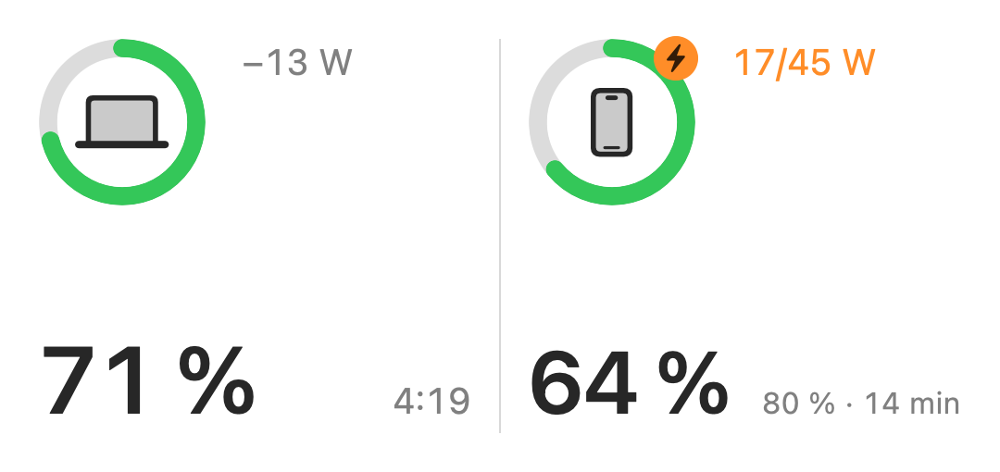
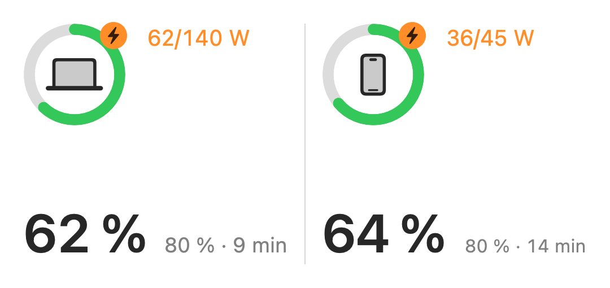
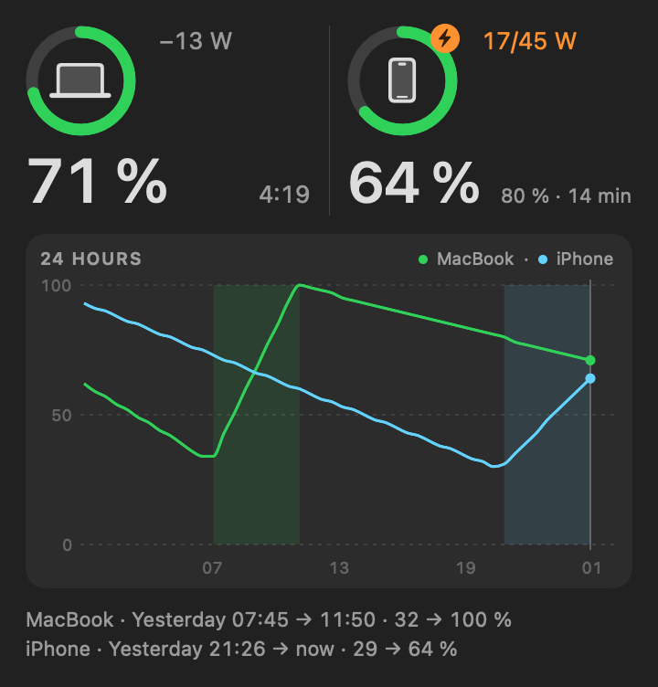
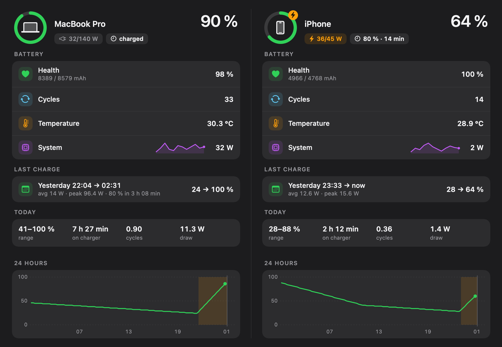
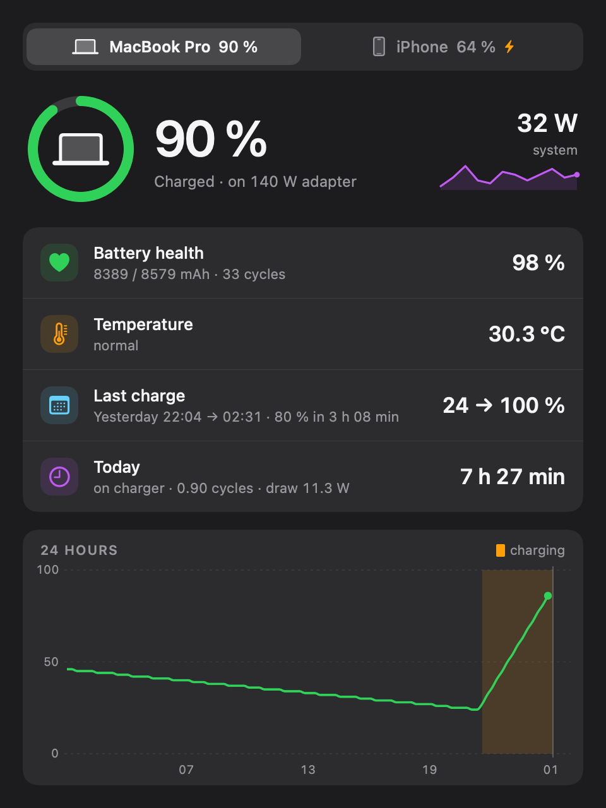
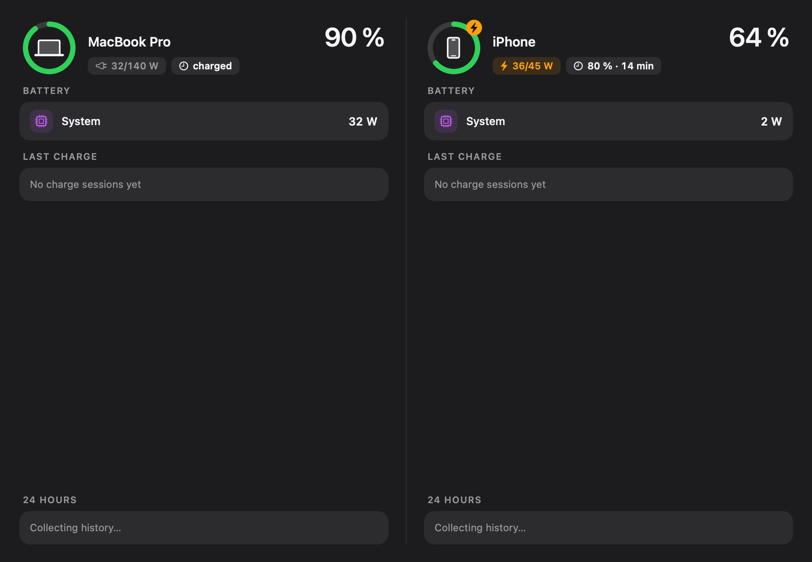

# Tandem

**MacBook and iPhone battery, side by side, on your Mac.** Tandem is a menu-bar
agent for macOS that shows both percentages in the menu bar, both devices in a
popover, three widget sizes on the desktop, and a summary window with 24 hours
of history — watts in and out, the adapter you are actually getting, and the
time left to 80 %. There is **no app on the phone**: after one cable pairing
("Trust This Computer"), Tandem reads the iPhone over Wi‑Fi by speaking Apple's
own lockdown protocol to it, the same way Finder does.

<p align="center">
  
</p>

## Showcase

| | |
|---|---|
|  | **Popover** — one row per device: level bar, system draw, adapter, and either time to 80 % or time left. |
|   | **Small widget** — nested rings, Mac outside and iPhone inside; charging on the right. |
|  | **Medium widget** — a ring, the wattage, the percent and the status for each device. |
|  | **Medium widget, both on a charger** — orange watts, the rated adapter, `80 % · 14 min`. |
|  | **Large widget** — the same two tiles plus a 24‑hour chart for both devices. |

The summary window comes in two layouts, chosen from the popover's overflow
menu:

| | |
|---|---|
|  | **Two columns** — both devices at once: health, cycles, temperature, system draw, the last charge session, today's totals and 24 hours of level. |
|  | **Tabs** — the same blocks, one device at a time, in a narrow window. |
|  | **Before any history exists** — live headers, and one honest sentence wherever a derived number would be. No placeholder zeroes. |

Every image above is rendered offscreen from the app's own SwiftUI views with
synthetic data (`tools/render-widget.swift`, `tools/render-summary.swift`,
`tools/render-popover.swift`), so a screenshot can never drift from the code —
and the repository ships no picture of anyone's desktop.

## Install

1. Download `Tandem-<version>.dmg` from the
   [Releases](https://github.com/Anato-Lich/Tandem/releases) page.
2. Open it and drag **Tandem** to Applications.
3. **The first launch will be refused, and that is expected.** The app is
   ad-hoc signed and *not* notarised — there is no paid Apple Developer
   identity behind it — so Gatekeeper blocks it and says the app "is damaged"
   or "cannot be opened". Nothing is damaged; macOS simply will not run
   downloaded code Apple has not stamped. Remove the download quarantine flag
   once:

   ```sh
   xattr -dr com.apple.quarantine /Applications/Tandem.app
   ```

   The alternative, if you would rather not use the terminal: right-click (or
   Control-click) Tandem in Applications, choose **Open**, and confirm in the
   dialog. On recent macOS you may instead need **System Settings → Privacy &
   Security → Open Anyway** after the first refusal.

   If neither appeals, build it yourself — see below; a locally built app is
   never quarantined.

### Requirements

- **macOS 15 or later.**
- **An iPhone paired to this Mac once over a cable.** Connect it, unlock it and
  tap **Trust This Computer**. This is the one hard requirement: without a pair
  record Tandem can see the phone but never read it.
- **Wi‑Fi sync enabled** for that iPhone ("Show this iPhone when on Wi‑Fi" in
  Finder). Tandem sets this itself when it pairs; you can also tick it by hand
  on Finder's device page.
- **Both devices on the same Wi‑Fi network.** After that the cable can go away.

The Mac's own battery needs nothing at all — it is an in-process IOKit read.

## How it works

- **The Mac** is read from the `AppleSmartBattery` / `IOPMPowerSource` entries
  in the IORegistry: level, current, voltage, cycle count, temperature, adapter
  wattage and Apple's own `PowerTelemetryData`. Free, instantaneous, always
  available.
- **The iPhone** is read over **lockdown** — the TLS protocol the phone speaks
  on port 62078 — using `diagnostics_relay` to fetch the same
  `AppleSmartBattery` entry from the device. Two routes race on every poll: a
  direct TLS client dialling the phone's remembered IP, and libimobiledevice
  via usbmuxd. Whichever answers first wins; if only the degraded `GetValue`
  tier answers, the percent still updates and the watt columns dim rather than
  vanish. The phone's Bonjour record disappears for tens of seconds at a time
  on Wi‑Fi, which is precisely why the direct route exists.
- **Polling is activity-based**, because every phone poll wakes `lockdownd` and
  the radio with it. How visible the readout is decides the cadence:

  | Activity level | iPhone, charging | iPhone, on battery |
  |---|---|---|
  | Popover open | 15 s | 15 s |
  | A widget asked for a timeline recently | 60 s | 120 s |
  | Menu bar only | 120 s | 300 s |
  | Display asleep or screen locked | not polled at all | not polled at all |

  An unreachable device backs off 60 s → 120 s → 300 s → 600 s. The Mac keeps a
  10-minute sanity read even while hidden, so the label is never hours stale on
  wake.
- **History** is a local SQLite database (30 days, a row written only when
  something material changes) that derives charge sessions, daily totals, a
  capacity trend and the 24-hour series the summary window and the large widget
  draw.

The full engineering account — every measurement, every dead end, the Bonjour
blackouts, the neighbour-table lookup that finds the phone's IPv4, the schema —
is in [`BatteryCore/NOTES.md`](BatteryCore/NOTES.md).

## Privacy

Everything stays on your Mac. Tandem has no network code beyond the LAN socket
it opens to your own iPhone: no server, no analytics, no account, no update
check. The history database and the snapshot files live in
`~/Library/Application Support/Tandem/`, and deleting that folder deletes
everything the app has ever recorded.

## Build from source

Needs Xcode (the full app — the Command Line Tools alone do not carry
swift-testing), [XcodeGen](https://github.com/yonaskolb/XcodeGen) and a handful
of Homebrew kegs. The kegs are a *build*-time dependency only: the finished
`.app` carries its own copies in `Contents/Frameworks`.

```sh
brew install xcodegen pkg-config libimobiledevice libusbmuxd libplist openssl@3

# The package: BatteryCore plus the tandemctl CLI
cd BatteryCore
swift build
DEVELOPER_DIR=/Applications/Xcode.app/Contents/Developer swift test

# The app: the Xcode project is generated from project.yml
cd ../TandemApp
xcodegen generate
DEVELOPER_DIR=/Applications/Xcode.app/Contents/Developer \
  xcodebuild -project Tandem.xcodeproj -scheme Tandem -configuration Debug build

open ~/Library/Developer/Xcode/DerivedData/Tandem-*/Build/Products/Debug/Tandem.app
```

`tandemctl` is built alongside the package and is the quickest way to find out
whether the phone answers at all: `once`, `watch`, `history`, `probe`,
`addresses`, `lockdown`, `dump` — run `tandemctl --help`, or see
`BatteryCore/NOTES.md` §17.

### Adding the widget

There is no scriptable way to place a widget: right-click the desktop →
**Edit Widgets** (or Control Centre → the clock → **Edit Widgets**), find
**Tandem** in the list and drag the size you want onto the desktop or into
Notification Centre. Launch `Tandem.app` once first, so the system registers
the extension.

## Project layout

| Path | What it is |
|---|---|
| `BatteryCore/` | A standalone Swift package: both battery sources, the lockdown client, the polling policy, the charge estimator, the SQLite history and the `tandemctl` CLI. No AppKit. |
| `BatteryCore/NOTES.md` | The engineering notes — the reasoning behind every decision above. |
| `TandemApp/Sources/Tandem/` | The app: menu-bar label, popover, summary window, the `tandem://summary` URL scheme, the 80 % notification. |
| `TandemApp/Sources/TandemWidget/` | The WidgetKit extension: small, medium and large. |
| `TandemApp/README.md` | The developer README for the app half, including the container trick the widget needs in the absence of an App Group. |
| `Fixtures/` | Real IORegistry dumps, with identifying values replaced by synthetic ones, that the parser tests run against. |
| `tools/` | The offscreen renderers behind `docs/`, the dylib bundler, the icon generator, the DMG script. |
| `docs/design/` | The design mock-ups the interface was built from. |

## Known limitations

- **Ad-hoc signed, not notarised.** Hence the quarantine step above. If a
  Developer ID ever appears, this all goes away.
- **No App Group.** Without a signing identity the app and the widget cannot
  share a container, so the app writes its snapshot straight into the
  extension's sandbox and the extension leaves an activity marker back in the
  same place. See `TandemApp/README.md`.
- **Wi‑Fi blackouts.** The phone drops out of usbmuxd's device list for ~40 s
  at a stretch. That is a property of usbmuxd and Bonjour, not of Tandem; the
  direct client works through most of them, and the polling policy deliberately
  does not treat a disappearing record as an event worth a poll.
- **No settings window.** The two preferences that survived — the summary
  layout and launch-at-login — live in the popover's overflow menu.

## Credits

- [libimobiledevice](https://libimobiledevice.org) and its family
  (`libusbmuxd`, `libimobiledevice-glue`, `libplist`) — the usbmuxd half of the
  phone read, and the reference implementation everything here was checked
  against.
- [AirBattery](https://github.com/lihaoyun6/AirBattery) — for the
  widget-container trick that lets an unsigned app and its sandboxed extension
  talk to each other, and for its notes on the BLE side of Apple device
  batteries.
- OpenSSL, for the TLS the direct lockdown client speaks.

Bundled third-party licences are listed in [`THIRD_PARTY.md`](THIRD_PARTY.md)
and shipped inside the app at `Tandem.app/Contents/Resources/Licenses/`.

## Licence

MIT — see [`LICENSE`](LICENSE).

---

## По‑русски

**Tandem** — агент в строке меню macOS, который показывает заряд MacBook и
iPhone рядом: два процента в строке меню, всплывающее окно с двумя
устройствами, три размера виджета и окно сводки с историей за сутки — ватты,
адаптер, время до 80 %. **На телефон ничего ставить не нужно**: после
однократного соединения кабелем и нажатия «Доверять этому компьютеру» Tandem
читает iPhone по Wi‑Fi напрямую, по протоколу lockdown, как это делает Finder.

**Установка.** Скачайте `Tandem-<версия>.dmg` из
[Releases](https://github.com/Anato-Lich/Tandem/releases) и перетащите
приложение в «Программы». Оно подписано ad‑hoc и не нотаризовано, поэтому macOS
откажется его открыть («повреждено»). Это ожидаемо — снимите карантинный флаг:

```sh
xattr -dr com.apple.quarantine /Applications/Tandem.app
```

Либо щёлкните по приложению правой кнопкой → «Открыть» и подтвердите.

**Требования:** macOS 15+, iPhone, один раз соединённый с этим Mac кабелем
(«Доверять этому компьютеру»), включённая синхронизация по Wi‑Fi (приложение
включает её само) и общая сеть Wi‑Fi.

**Как это устроено.** Mac читается через IOKit, iPhone — через
lockdown/`diagnostics_relay` по Wi‑Fi (прямой TLS-клиент и usbmuxd работают в
гонке); частота опроса зависит от того, смотрит ли кто-нибудь на показания
(таблица уровней выше), история хранится локально в SQLite 30 дней. Ничего не
уходит в сеть дальше вашего собственного телефона. Подробности —
в [`BatteryCore/NOTES.md`](BatteryCore/NOTES.md), план работ — в
[`PLAN.md`](PLAN.md).
